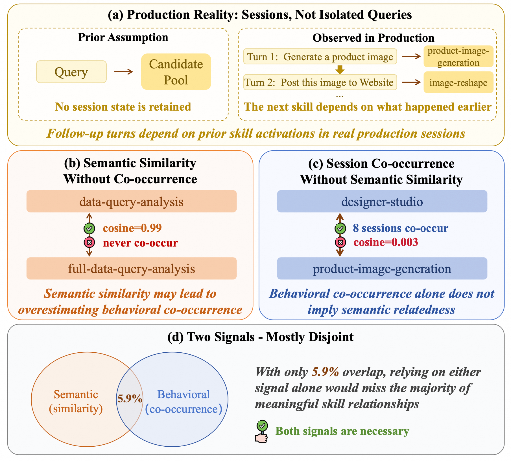
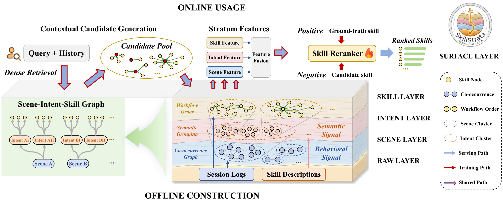
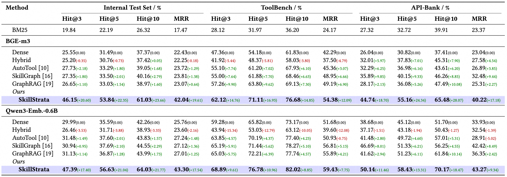
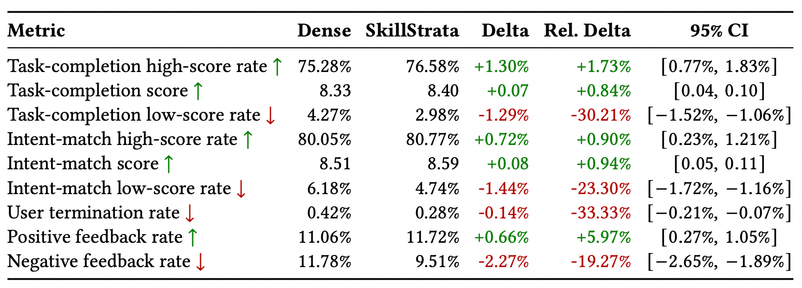
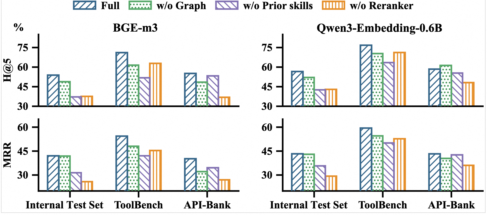

# SkillStrata: Mining Layered Skill Graphs for Session-Aware Agent Routing

<p align="center">
  KDD 2027 · Applied Data Science Track
</p>

SkillStrata is a layered skill-graph mining framework for multi-turn skill routing in LLM agent
platforms. It maps session logs and skill descriptions into behavioral scenes, mined intent groups,
and directed workflow edges, and serves the resulting Scene–Intent–Skill graph through lookup
features for session-aware next-skill ranking. No router LLM is added at serving time.

This repository provides the SkillStrata implementation, the converted ToolBench and API-Bank
datasets, and the configuration used for the public-benchmark experiments.

## Contents

- [Why Session-Aware Routing?](#why-session-aware-routing)
- [Method](#method)
- [Results](#results)
- [Getting Started](#getting-started)
- [License](#license)

## Why Session-Aware Routing?

In production agent platforms, users rarely restate the full task context in follow-up turns.
A user may first ask for *"generate a product image"* and then say *"post this image to the
website"*. The second query refers to an output of the earlier skill call, so the correct next
skill is weakly indicated by the current utterance but determined by session history.

Skill relations are also heterogeneous. In Wukong, Alibaba Group's production agent platform,
`data-query-analysis` and `full-data-query-analysis` have a description cosine of 0.99 yet never
co-occur, while `designer-studio` and `product-image-generation` co-occur in 8 sessions with a
cosine of 0.003. Over the offline Wukong corpus, semantic and behavioral signals overlap by only
5.9%.

<p align="center">
  
</p>

## Method

SkillStrata keeps three relation strata separate:

| Stratum | Signal | Meaning |
| --- | --- | --- |
| Scene | Session-level co-activation (NPMI-weighted graph, Louvain clustering) | Usage context |
| Intent | Description similarity within each scene (average-linkage clustering) | Callable intent proximity |
| Skill | Adjacent-turn transitions, `P(b \| a)` | Skill-level workflow order |

<p align="center">
  
</p>

### Offline graph construction

The scene layer clusters skills on the NPMI-weighted
co-activation graph. Rare or new skills without behavioral edges are assigned to the nearest
scene centroid in description-embedding space. The intent layer groups skills by description
similarity inside each scene, and the skill layer stores directed workflow edges estimated from
adjacent turns. Construction uses only session logs and skill descriptions and does not call an
LLM. In Wukong serving, the graph is rebuilt offline every day.

### Strata-enhanced skill routing

Online routing has three steps:

1. *Contextual candidate generation.* The pool starts from the top-k dense seeds and the prior
   skills, then adds co-activation neighbors, workflow successors of prior skills, and skills in
   the same scene as prior skills.
2. *Stratum feature fusion.* Each candidate receives three features: intent proximity (maximum
   description similarity to prior skills), skill-layer workflow recency (transition
   probabilities from prior skills, weighted toward recent turns), and scene compatibility
   (similarity between the query and the candidate's scene centroid).
3. *Reranking.* A LambdaMART reranker scores the fused features, and its score is combined with
   the dense score.

For first-turn queries without prior skills, routing falls back to query–scene compatibility
within the generated pool. In a serving benchmark under the same hardware and workload,
SkillStrata increased mean routing latency by 31.02 ms relative to Dense.

## Results

### Offline next-skill routing

We evaluate on held-out Wukong traffic (Internal Test Set) and on ToolBench and API-Bank, where
each trajectory step is converted into a next-skill routing instance. All methods are run with
BGE-m3 and Qwen3-Embedding-0.6B. SkillStrata outperforms lexical, dense, hybrid, graph-aware, and
workflow-aware baselines on all three datasets under both backbones, with Hit@10 gains over Dense
ranging from 8.85 to 28.07 points.

<p align="center">
  
</p>

### Online A/B test

The 7-day A/B test on Wukong covered 99,355 production dialogues and was randomized at the
complete-dialogue level. Both arms shared the same fine-tuned BGE-m3 encoder, skill pool, and
executor; only the routing layer differed. SkillStrata lowered the task-completion low-score rate
from 4.27% to 2.98% (a 30.21% relative reduction), user termination from 0.42% to 0.28%, and
negative feedback from 11.78% to 9.51%.

<p align="center">
  
</p>

### Component ablation

Removing prior skills causes large, consistent drops: on the internal test set, Hit@5 falls by
14–17 points across the two backbones. Removing the reranker lowers it by 13–16 points. Graph
expansion adds recall but cannot replace history conditioning or reranking. Appending prior-skill
text to the query helps query-centered baselines on Wukong but often lowers MRR or Hit@3 on
ToolBench and API-Bank, and still trails SkillStrata.

<p align="center">
  
</p>

## Getting Started

### Project layout

- `data/`: converted ToolBench and API-Bank datasets. Each dataset has `skills.json` (skill
  names and descriptions) and `train_sessions.json` / `test_sessions.json` (ordered
  query–skill turns per session)
- `skillstrata/`: the implementation. `prepare.py` turns sessions into routing records and
  counts co-activation and adjacent-turn edges from training sessions only; `graph.py` builds
  scenes and workflow transitions; `router.py` handles candidate generation, stratum features,
  and reranking
- `experiment_config.json`: all experiment settings
- `run.py` / `run.sh`: entry point and launcher

### Run

```bash
pip install -r requirements.txt
./run.sh                                      # both backbones on both datasets
MODEL=bge-m3 DATASET=api_bank ./run.sh        # a single combination
DEVICE=cpu ./run.sh                           # run on CPU
```

Results are saved to `results/<model>/<dataset>.json`.

### Key parameters

All settings are in `experiment_config.json`:

- `scene_resolution`: Louvain resolution for scene clustering
- `expansion_coactivation_min`: co-activation threshold for neighbor expansion
- `dense_seed_count`: number of dense seeds (k)
- `pool_cap`: cap on non-mandatory expansion candidates (`null` means no cap)
- `ranker_weight` / `pool_bonus`: ranker weight and pool bonus used in score fusion
- `lightgbm`: LambdaMART hyperparameters

## License

This project is released under the [MIT License](LICENSE).
